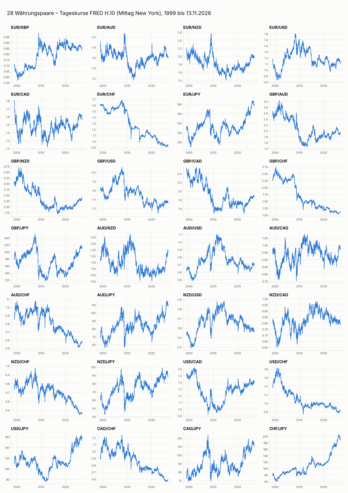

# Phase 1 – Kursdaten und Datenqualität

Erstellt am 18.11.2026 · automatisch erzeugt von `python -m forex_nexus report-fx`

## Datenbestand

| Quelle | Paare | von | bis | Tageswerte |
|---|---|---|---|---|
| FRED H.10 + Kreuzkurse | 28 | 04.01.1999 | 13.11.2026 | 195.664 |
| EZB-Referenzkurse | 7 | 04.01.1999 | 17.11.2026 | 49.966 |

## Befunde der Qualitätsprüfung (ab 04.01.1999)

Geprüft wird der Zeitraum seit Einführung des Euro. Ältere FRED-Daten (ab 1971) bleiben gespeichert,
werden aber vorerst nicht für Modelle verwendet (u. a. feste Wechselkurse bis 1973).

| Prüfung | Anzahl |
|---|---|
| Extreme Marktbewegung (Info) | 100 |
| Abweichung FRED/EZB | 37 |

## Kontrolle FRED gegen EZB (gleiche Tage, EUR-Paare)

FRED misst um 12:00 New York, die EZB um 14:15 MEZ – also ca. 4 Stunden früher.
Kleine Unterschiede sind daher normal; große Unterschiede deuten auf Datenfehler oder sehr bewegte Tage hin.

| Paar | gemeinsame Tage | mittlere Abweichung | 99-%-Abweichung | Tage > 2 % |
|---|---|---|---|---|
| EURAUD | 6897 | 0.175 % | 1.099 % | 9 |
| EURCAD | 6897 | 0.212 % | 1.182 % | 5 |
| EURCHF | 6897 | 0.086 % | 0.716 % | 3 |
| EURGBP | 6897 | 0.139 % | 0.855 % | 0 |
| EURJPY | 6897 | 0.183 % | 1.227 % | 9 |
| EURNZD | 6897 | 0.182 % | 1.151 % | 6 |
| EURUSD | 6897 | 0.179 % | 1.138 % | 5 |

## Einzelbefunde

### Tage mit extremen Marktbewegungen

Echte Marktereignisse (die Bewegung bleibt bestehen). Kein Datenfehler, aber wichtig für die Modelle.

| Datum | Paare |
|---|---|
| 2000-01-28 | 1: AUDCAD |
| 2007-08-16 | 13: AUDCAD, AUDCHF, AUDJPY, AUDUSD, EURAUD, EURJPY, EURNZD, GBPAUD, GBPNZD, NZDCAD, NZDCHF, NZDJPY, NZDUSD |
| 2008-03-17 | 3: EURGBP, GBPCHF, GBPJPY |
| 2008-10-06 | 10: AUDCAD, AUDCHF, AUDJPY, AUDUSD, CHFJPY, EURAUD, EURJPY, GBPAUD, GBPJPY, NZDJPY |
| 2008-10-08 | 7: AUDCAD, AUDCHF, AUDJPY, AUDUSD, EURAUD, EURNZD, GBPAUD |
| 2008-10-10 | 5: AUDCHF, AUDJPY, AUDUSD, EURAUD, GBPAUD |
| 2008-10-24 | 8: AUDCAD, AUDCHF, AUDJPY, AUDUSD, EURAUD, EURJPY, GBPJPY, NZDJPY |
| 2008-10-29 | 1: AUDJPY |
| 2011-09-06 | 6: AUDCHF, CADCHF, CHFJPY, EURCHF, GBPCHF, USDCHF |
| 2015-01-15 | 7: AUDCHF, CADCHF, CHFJPY, EURCHF, GBPCHF, NZDCHF, USDCHF |
| 2015-01-16 | 7: AUDCHF, CADCHF, CHFJPY, EURCHF, GBPCHF, NZDCHF, USDCHF |
| 2015-01-20 | 3: EURCHF, GBPCHF, USDCHF |
| 2015-01-21 | 2: CADCHF, NZDCHF |
| 2015-01-26 | 1: EURCHF |
| 2015-08-24 | 3: AUDJPY, EURNZD, NZDJPY |
| 2016-06-24 | 9: CHFJPY, EURGBP, EURJPY, GBPAUD, GBPCAD, GBPCHF, GBPJPY, GBPNZD, GBPUSD |
| 2020-03-09 | 2: CADJPY, USDJPY |
| 2020-03-12 | 2: AUDCAD, AUDUSD |
| 2020-03-18 | 1: USDCAD |
| 2022-05-12 | 1: EURJPY |
| 2022-06-16 | 1: USDCHF |
| 2025-04-04 | 7: AUDCAD, AUDCHF, AUDUSD, EURAUD, EURNZD, GBPAUD, NZDCHF |

### Weitere Befunde

| Prüfung | Paar | Datum | Details |
|---|---|---|---|
| Abweichung FRED/EZB | EURAUD | 2000-01-28 | log_diff_pct: 2.66, primary: 1.55865922, control: 1.5178 |
| Abweichung FRED/EZB | EURJPY | 2000-10-18 | log_diff_pct: -2.01, primary: 90.438198, control: 92.27 |
| Abweichung FRED/EZB | EURAUD | 2008-10-06 | log_diff_pct: 3.79, primary: 1.89214176, control: 1.8218 |
| Abweichung FRED/EZB | EURJPY | 2008-10-06 | log_diff_pct: -2.88, primary: 136.782008, control: 140.78 |
| Abweichung FRED/EZB | EURNZD | 2008-10-06 | log_diff_pct: 2.55, primary: 2.15644955, control: 2.1021 |
| Abweichung FRED/EZB | EURAUD | 2008-10-08 | log_diff_pct: 2.11, primary: 2.04484305, control: 2.0022 |
| Abweichung FRED/EZB | EURAUD | 2008-10-29 | log_diff_pct: -2.28, primary: 1.9229388, control: 1.9672 |
| Abweichung FRED/EZB | EURJPY | 2008-10-30 | log_diff_pct: -2.74, primary: 125.24895, control: 128.73 |
| Abweichung FRED/EZB | EURAUD | 2008-11-03 | log_diff_pct: -2.44, primary: 1.86413601, control: 1.9102 |
| Abweichung FRED/EZB | EURNZD | 2008-11-03 | log_diff_pct: -2.55, primary: 2.12870293, control: 2.1836 |
| Abweichung FRED/EZB | EURJPY | 2008-11-04 | log_diff_pct: 2.7, primary: 130.835008, control: 127.35 |
| Abweichung FRED/EZB | EURJPY | 2008-11-10 | log_diff_pct: -2.29, primary: 124.99696, control: 127.89 |
| Abweichung FRED/EZB | EURAUD | 2008-11-12 | log_diff_pct: 2.5, primary: 1.94727865, control: 1.8992 |
| Abweichung FRED/EZB | EURNZD | 2008-11-12 | log_diff_pct: 2.11, primary: 2.22659574, control: 2.1801 |
| Abweichung FRED/EZB | EURCAD | 2008-11-24 | log_diff_pct: -2.19, primary: 1.5785094, control: 1.6134 |
| Abweichung FRED/EZB | EURJPY | 2009-01-09 | log_diff_pct: -2.12, primary: 121.792375, control: 124.4 |
| Abweichung FRED/EZB | EURJPY | 2009-01-21 | log_diff_pct: -2.72, primary: 112.9986, control: 116.11 |
| Abweichung FRED/EZB | EURJPY | 2010-02-04 | log_diff_pct: -2.48, primary: 122.606449, control: 125.68 |
| Abweichung FRED/EZB | EURCHF | 2011-08-11 | log_diff_pct: 2.42, primary: 1.0756457, control: 1.0499 |
| Abweichung FRED/EZB | EURCHF | 2011-08-16 | log_diff_pct: 2.08, primary: 1.14300846, control: 1.1195 |
| Abweichung FRED/EZB | EURCHF | 2015-01-16 | log_diff_pct: -3.54, primary: 0.97756296, control: 1.0128 |
| Abweichung FRED/EZB | EURCAD | 2015-01-21 | log_diff_pct: 2.39, primary: 1.43375168, control: 1.3999 |
| Abweichung FRED/EZB | EURAUD | 2015-12-03 | log_diff_pct: 2.47, primary: 1.49138167, control: 1.455 |
| Abweichung FRED/EZB | EURCAD | 2015-12-03 | log_diff_pct: 2.69, primary: 1.46010486, control: 1.4213 |
| Abweichung FRED/EZB | EURNZD | 2015-12-03 | log_diff_pct: 2.45, primary: 1.64360018, control: 1.6038 |
| Abweichung FRED/EZB | EURCAD | 2016-01-21 | log_diff_pct: -2.05, primary: 1.54305252, control: 1.575 |
| Abweichung FRED/EZB | EURAUD | 2016-03-10 | log_diff_pct: 3.2, primary: 1.49946265, control: 1.4522 |
| Abweichung FRED/EZB | EURCAD | 2016-03-10 | log_diff_pct: 3.42, primary: 1.49258264, control: 1.4424 |
| Abweichung FRED/EZB | EURAUD | 2020-03-19 | log_diff_pct: -2.03, primary: 1.82607954, control: 1.8635 |
| Abweichung FRED/EZB | EURJPY | 2022-10-21 | log_diff_pct: -2.3, primary: 144.227925, control: 147.59 |

(Nur die ersten 30 von 37 Abweichungen gezeigt; alle stehen in der Datenbank.)
